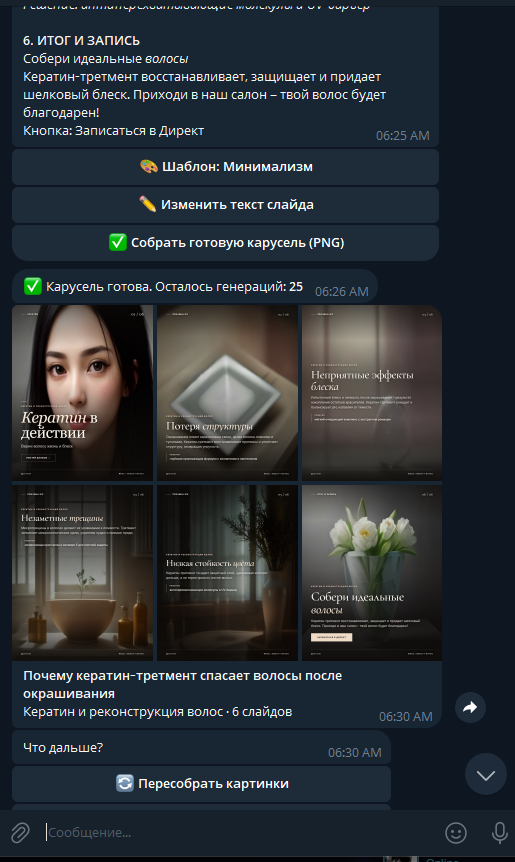

# 🎠 AI Carousel Generator Bot

> **AI-пайплайн + Telegram-бот для автоматической генерации и верстки визуальных каруселей** для Instagram, Telegram и других соцсетей.
> Пользователь пишет тему — бот за секунды собирает сценарий, генерирует фоновые иллюстрации и рендерит готовые слайды в PNG 1080×1350.

<p align="left">
  
  
  
  
  
  
  
</p>

---

## 📸 Как это выглядит в Telegram

<p align="center">
  
</p>

<p align="center">
  <sub>Один запрос в чате — и бот отдаёт готовую карусель: сценарий, тексты и сверстанные слайды 1080×1350.</sub>
</p>

---

## 🧩 Какую задачу бизнеса решает

Контент-мейкеры и SMM-специалисты ежедневно тратят **часы** на рутинную верстку каруселей: придумать сценарий, подобрать фото, написать текст, разложить его по слайдам, выровнять плашки и градиенты.

Бот закрывает этот цикл целиком:

| Было | Стало |
|---|---|
| 2–4 часа дизайнера на одну карусель | **Готовая карусель за секунды** |
| Подбор стоковых фото и лицензий | **Уникальные иллюстрации нейросети** |
| Ручная верстка в Figma/Canva | **Детерминированный шаблонный рендеринг** |
| Разный стиль от поста к посту | **Единый брендбук на каждом слайде** |

Это пример **production-ready автоматизации контента**: вместо найма дизайнера на каждый пост бизнес получает масштабируемый конвейер, который окупается на первой же сотне слайдов.

---

## 🏗 Архитектура и возможности

Пайплайн построен как **цепочка независимых провайдеров** за общими интерфейсами (`BaseLLMProvider`, `BaseImageProvider`), поэтому любого поставщика можно заменить без изменения бизнес-логики.

```
Тема пользователя
        │
        ▼
┌─────────────────────────────────────────────┐
│ 1. LLM: сценарий + тексты + промпты          │  OpenAI-compatible API
│    строгий JSON (slides: badge/title/…)     │  Free · OpenRouter
└─────────────────────────────────────────────┘
        │
        ▼
┌─────────────────────────────────────────────┐
│ 2. Image: фоновые иллюстрации                │  Flux · Stable Diffusion (HF)
│    уникальный визуальный промпт на слайд    │  Pollinations · HF Inference
└─────────────────────────────────────────────┘
        │
        ▼
┌─────────────────────────────────────────────┐
│ 3. Renderer: динамическая верстка → PNG      │  Playwright + Jinja-free CSS
│    типографика, плашки, градиенты           │  auto-fit заголовка, 3 темы
└─────────────────────────────────────────────┘
        │
        ▼
   Telegram: альбом или PNG-файлы
```

### 🧠 Генерация структуры, сценария и промптов через LLM

* Многоуровневый **system prompt** задаёт жёсткие правила формата: ровно N слайдов, конкретные поля, обязательный акцент в `<em>`.
* Модель возвращает **строго валидированный JSON**, который проверяется через **Pydantic** (`CarouselContent` / `SlideContent`).
* **Отказоустойчивость по слоям**: автоповтор без JSON-режима, если провайдер не поддерживает `response_format`; починка ответа, если модель завернула JSON в markdown-фенсы; отсечение лишних слайдов и мягкая нормализация строк.
* Повторные попытки с **экспоненциальной задержкой** и отдельной стратегией для `402/429` (rate limit) и `5xx`.
* Отдельный модуль `prompts.py` генерирует **визуальные роли** для каждого слайда (обложка → предметные макро-кадры → атмосфера → финал), чтобы иллюстрации в карусели не дублировались.

### 🎨 Генерация фоновых иллюстраций через нейросети (Flux / Stable Diffusion)

* **Pollinations FLUX** — бесплатный старт без ключей, с жёстким внутренним лимитером «1 изображение / 45 сек».
* **Hugging Face Serverless Inference** — Stable Diffusion через `router.huggingface.co`, с обработкой `402` (кредиты), `429` (rate limit) и `503` (`estimated_time`, прогрев модели).
* **Конкурентная загрузка** изображений через `asyncio.gather` + `Semaphore`.
* Проверка **магических байтов** (JPEG/PNG/WebP/AVIF) вместо доверия `Content-Type`, защита от битых ответов.
* Если картинка не сгенерировалась — слайд не ломается, рендерится с градиентной подложкой.

### 🖋 Динамический рендеринг типографики и верстки

Рендер живёт в `services/renderer/` и построен на **HTML/CSS + headless Chromium (Playwright)**:

* **Три дизайн-темы**: журнальный `editorial`, матовый нуар `matte_cards`, `minimal`.
* **Типографика с auto-fit**: JS-скрипт в реальном времени уменьшает кегль заголовка, пока он не поместится в безопасную область — длинные русские заголовки не вылезают за плашку.
* **Градиентные оверлеи и стеклянные плашки** (`backdrop-filter`, `linear-gradient`) для читаемости текста поверх любых фото.
* **Многострочная верстка**: поддержка переносов строк, курсивных акцентов, бейджей, блоков «Решение», кнопок CTA и счётчиков слайдов.
* Ожидание загрузки веб-шрифтов (`document.fonts.ready`) — текст никогда не «съезжает» на скриншотах.
* **Валидация выходного PNG** по сигнатуре и размеру кадра (ровно 1080×1350) на каждом слайде.

### ⚡ Асинхронность и UX

* Полностью асинхронный стек на **`aiogram` 3.x** + **`asyncio`**: сетевые вызовы LLM и картинок идут параллельно, событийный цикл не блокируется.
* **FSM-сценарий**: выбор ниши → тема → предпросмотр → правка конкретного поля → сборка → результат.
* **Редактирование на лету**: пользователь меняет текст слайда, шаблон или пересобирает только картинки.
* **Middleware-слой**: сессия БД и контейнер сервисов инжектятся в каждый handler.
* **Freemium + Telegram Stars**: лимит бесплатных генераций, подписка, идемпотентная обработка платежей по `charge_id`.
* **Graceful degradation**: ошибки провайдеров превращаются в понятные сообщения, а списанная генерация возвращается пользователю.

---

## 🛠 Технологический стек

| Слой | Технологии |
|---|---|
| **Язык / рантайм** | Python 3.11+ |
| **Bot framework** | `aiogram` 3.x (Router, FSM, middlewares, filters) |
| **Асинхронность** | `asyncio`, `aiohttp`, `asyncio.Semaphore` |
| **LLM** | OpenAI-compatible API, OpenRouter (Gemini Flash и др.), Pydantic-валидация |
| **Генерация изображений** | Flux (Pollinations), Stable Diffusion (Hugging Face Inference) |
| **Рендеринг** | Playwright (headless Chromium) + HTML/CSS-шаблоны, auto-fit типографики |
| **Хранение** | SQLAlchemy 2.0 (async) + SQLite (`aiosqlite`) |
| **Конфигурация** | `python-dotenv` + `pydantic` Settings |
| **Платежи** | Telegram Stars (`XTR`, `send_invoice` / `pre_checkout_query`) |

> **Примечание по стеку.** В этой реализации верстка слайдов выполняется HTML/CSS-движком Chromium через Playwright — это даёт полноценный CSS (градиенты, `backdrop-filter`, веб-шрифты, гибкая сетка), который собрать вручную на Pillow значило бы написать собственный layout-движок. Архитектура рендера изолирована за интерфейсом `CarouselRenderer`, поэтому алгоритмический вариант на `Pillow` подключается как альтернативный бэкенд без изменения остального кода.

---

## 📁 Структура проекта

```
ai_beauty_carousel_premium/
├── main.py                      # Точка входа: Bot + Dispatcher, polling, middleware
├── config.py                    # Pydantic-Settings, чтение .env, валидация режимов
├── requirements.txt
├── .env.example                 # Шаблон конфигурации (без секретов)
│
├── bot/                         # Telegram-слой
│   ├── constants.py             # Ниши, темы, брендинг, поля для правки
│   ├── utils.py                 # Хелперы: безопасный HTML, превью, ошибки
│   ├── handlers/
│   │   ├── start.py             # Онбординг: Instagram-ник, меню, профиль
│   │   ├── carousel.py          # FSM-сценарий генерации и сборки карусели
│   │   ├── payment.py           # Telegram Stars: инвойс и активация подписки
│   │   └── errors.py            # Глобальный обработчик исключений
│   ├── keyboards/inline.py      # Инлайн-клавиатуры
│   ├── middlewares/             # DB-сессия и контейнер сервисов
│   └── states/carousel.py       # FSM-состояния
│
├── services/                    # Бизнес-логика и провайдеры
│   ├── container.py             # DI-контейнер сервисов
│   ├── carousel_service.py      # Оркестратор: LLM → Image → Render
│   ├── llm/
│   │   ├── prompts.py           # System prompt + генератор визуальных промптов
│   │   ├── models.py            # Pydantic-схемы карусели
│   │   ├── openai_compatible.py # HTTP-клиент, retry, парсинг JSON
│   │   ├── openrouter.py        # Платный провайдер
│   │   └── free.py              # Бесплатный провайдер
│   ├── image_gen/
│   │   ├── free.py              # Pollinations FLUX
│   │   ├── local_sd.py          # FLUX с лимитером запросов
│   │   ├── huggingface.py       # Stable Diffusion (HF Inference)
│   │   └── factory.py           # Выбор провайдера по IMAGE_MODE
│   └── renderer/
│       ├── renderer.py          # Playwright-рендерер, auto-fit, валидация PNG
│       └── templates/           # slide.html + base.css + 3 темы
│
├── database/                    # SQLAlchemy-слой
│   ├── models.py                # User, Payment
│   ├── crud.py                  # Генерации, подписки, идемпотентность платежей
│   └── session.py               # Async engine / sessionmaker
│
├── ai_carousel_ollama.py        # Offline-демо: карусель из фото Unsplash
├── test_hf_standalone.py        # Изолированный тест HF-провайдера
└── setup_windows.bat            # Установка окружения под Windows
```

---

## 🚀 Быстрый старт и установка

### 1. Клонирование

```bash
git clone https://github.com/<your-username>/ai-carousel-generator-bot.git
cd ai-carousel-generator-bot
```

### 2. Виртуальное окружение

```bash
python -m venv .venv
# Windows
.venv\Scripts\activate
# macOS / Linux
source .venv/bin/activate
```

### 3. Зависимости

```bash
pip install -r requirements.txt
playwright install chromium   # headless-браузер для рендеринга слайдов
```

### 4. Настройка `.env`

```bash
cp .env.example .env      # Windows: copy .env.example .env
```

Минимально заполните:

```dotenv
BOT_TOKEN=123456789:your_bot_token_from_BotFather
AI_MODE=free          # или paid + OPENROUTER_API_KEY
IMAGE_MODE=free       # free | local | hf
```

Полный список параметров с комментариями — в [`.env.example`](.env.example).

### 5. Запуск

```bash
python main.py
```

**Windows-альтернатива:** запустите `setup_windows.bat` (установка окружения), затем `run_bot.bat`.

Без Telegram можно посмотреть сам движок верстки в офлайн-демо — оно подбирает фото через Unsplash и рендерит 6 слайдов:

```bash
python ai_carousel_ollama.py
```

---

## 🔐 Безопасность и конфигурация

* **Никаких секретов в коде** — все ключи читаются через `os.getenv` / `python-dotenv`.
* `.env` исключён из репозитория; в гите лежит только `.env.example`.
* `.gitignore` закрывает БД (`*.db`, `*.sqlite`), логи, `output/`, `generated/`, `generated_carousel/`, `__pycache__/`, виртуальные окружения.
* Персональные данные клиентов (Telegram ID, ники) живут только в локальной БД и не попадают в репозиторий.
* Брендинг слайдов задаётся в `bot/constants.py` — проект поставляется с нейтральными демо-значениями.

---

## 🗺 Roadmap

- [ ] Бэкенд рендера на Pillow для окружений без Chromium
- [ ] Реализация провайдеров Fal.ai и Replicate
- [ ] Хранение FSM-состояний в Redis (горизонтальное масштабирование)
- [ ] Автопубликация в Instagram Graph API
- [ ] A/B-тестирование тем по метрикам вовлечённости
- [ ] Покрытие тестами (`pytest` + `pytest-asyncio`) и Docker-образ

---

## 📄 Лицензия

Код открыт для ознакомления как портфолио-проект.
Названия брендов, ключи API и данные клиентов в репозитории отсутствуют и заменены нейтральными примерами.
